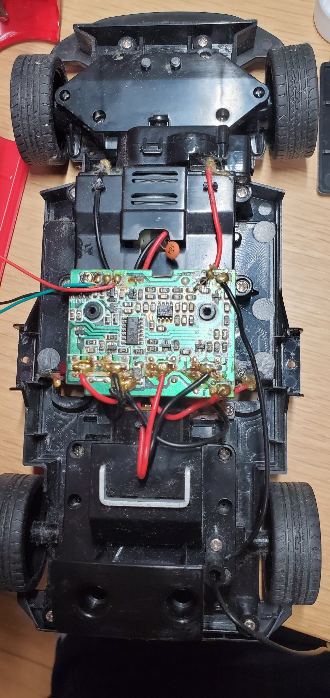
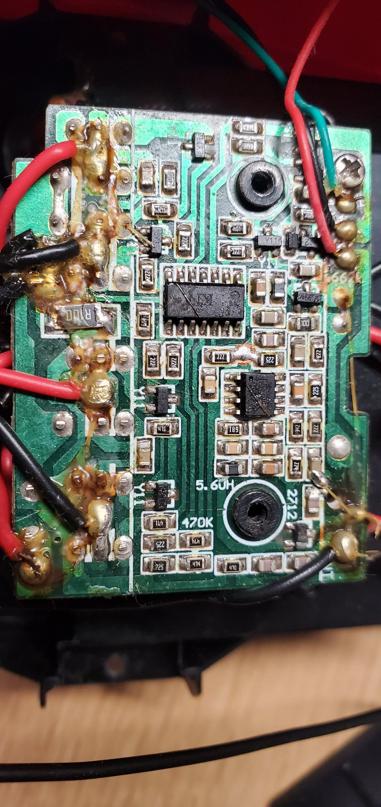
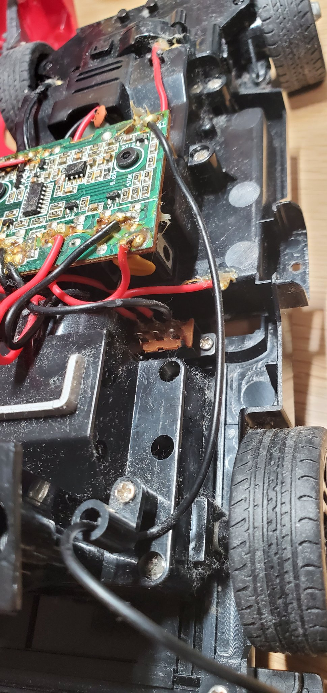
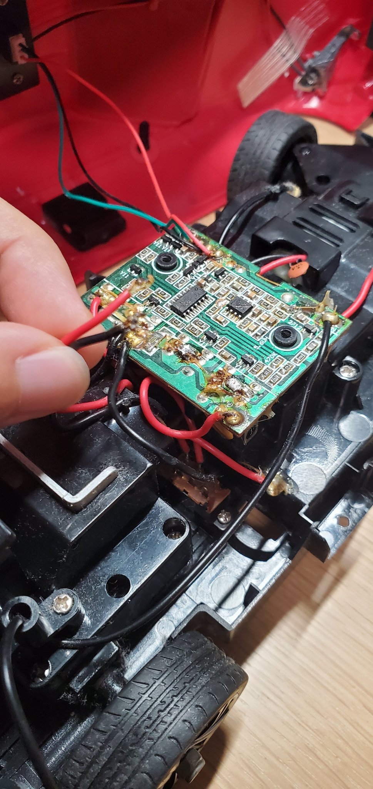
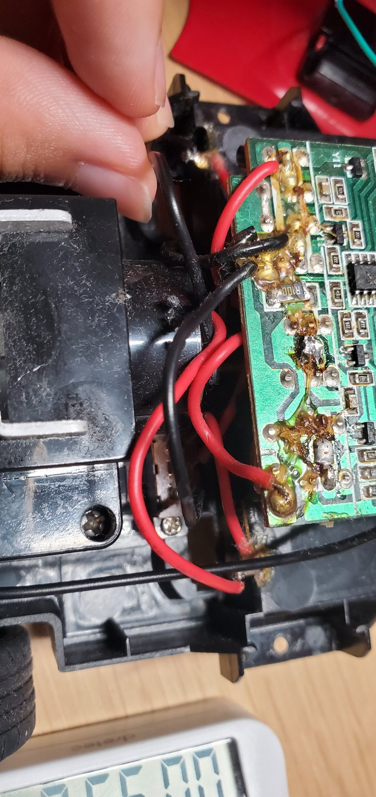
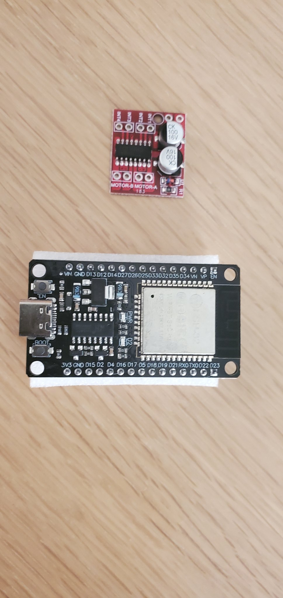

スマートフォンを頭脳にした自律走行ロボットを個人で作っています。前回は頭脳側の地図化の仕組みをシミュレーションで測定した結果を書きました。今回は車体側の話です。

車体は市販のトイラジコン（ジョーゼン ダートマックス 1/16 トヨタ86 ドリフトドライブ、型番 JRVC015-RD）です。この車の受信機基板を取り外し、代わりにマイコン（ESP32）とモータードライバを入れて、スマホからモーターを回す計画です。

そのために、基板に出入りしている配線が全部どこへ行っているのかを先に特定しました。電子工作は今回が初めてです。

結論を先に書きます。

- 基板の太い線は赤3本・黒4本の計7本で、全部の行き先を特定できた
- 前のモーターは操舵用だった。車軸にはつながっていない
- 電源スイッチは車体の裏側にあり、改造後もそのまま使える
- 駆動モーターの線を基板から外すところまでは進んだ。モーター自体が生きているかは、まだ確定していない
- ハンダ作業で基板側を焦がした。以後の配線はハンダを前提にしない方針に変えた

## 分解

外側の殻は、本のように片側から開きます。殻と基板の間はライトの線でつながっているので、無理に開くと切れます。緑色のライトの線は殻の内側に接着されていて、これは剥がさないことにしました。

中は埃と髪の毛がかなり入っていました。中央の黒い箱の中に緑色の受信機基板があり、基板の前に通気口のある黒い箱、後ろに電池ボックスがあります。

殻を開けた状態。前が上で、中央が受信機基板、上が前モーターの箱、下が電池ボックス。

## 配線の追い方

やったことは単純で、写真を撮って、線を1本ずつ目で追うことです。

最初は基板の左から何番目かで呼んでいましたが、途中でやめました。途中で重なっている接点があり、数え方がぶれるからです。行き先と色で呼ぶ形に変えました（例：後ろモーターの赤）。

受信機基板。太い線の接点は左端と下部に固まっている。細い赤・緑・黒はライト用。

特定できた配線は次の通りです。

| 線 | 行き先 |
|---|---|
| 太い赤・黒の組（基板の右寄り） | 後ろのモーター（駆動用） |
| 太い赤（基板の左端）ほか | 前のモーター（操舵用） |
| 赤・赤・黒 | 電源スイッチを経由して電池ボックスへ |
| 細い赤・緑・黒 | ライト（殻の側へ） |
| 黒1本（基板の右上から後ろへ） | アンテナ |

前のモーターが操舵用だと分かった根拠は、モーターの軸がどこにもつながっていないことです。タイヤを動かす軸ではなく、ステアリングの機構側を動かす作りでした。駆動は後ろのモーターです。

操舵が比例制御（少しずつ曲がる）なのか、オンオフ（切るか切らないか）なのかは、通電してみないと分かりません。これは残っています。

## 電源スイッチ

電源スイッチは車体の裏側にあるスライド式のつまみでした。本体は茶色い部品で、線は赤・赤・黒の3本です。電池のプラス側がスイッチを通って基板に入る作りでした。

このスイッチは改造後の主電源としてそのまま使えます。電池ボックスの端子も確認しましたが、腐食はありませんでした。

基板と、その下に見える茶色いスイッチ本体。

## 駆動モーターの線を外す

特定できたので、駆動モーターの線2本を基板から外しました。ハンダごてを使う作業自体が初めてです。

外した駆動モーターの線。

外すことはできました。ただ、基板側の接点は焦げて、近くのプラスチックも少し溶けました。基板は取り替える側なので実害はありませんが、ハンダ付けの作業に慣れていないことははっきりしました。

作業後の基板。接点の周りが焦げている。

## 方針の変更：ハンダを前提にしない

この結果を受けて、以後の配線はハンダ付けを前提にしない形に変えました。

モータードライバは、当初買った MX1508（端子が小さく、ハンダ付けが前提）から、ネジ端子で線を留める L298N のモジュールに替えます。線の先を少し剥いて、ネジで締めるだけです。

代償はあります。L298N は電圧が約2V落ちるので、モーターに届く電圧が下がって遅くなります。室内で地図を作る実験では、速さより確実に配線できることを取りました。

使う予定の基板2種。黒い方がマイコンの ESP32、赤い方が当初予定していたモータードライバ（MX1508）。赤い方は上記の方針変更で使わないことになった。

## 残っていること

- 駆動モーターの動作確認。電池1本（1.5V）を当てても弱くて判定できなかった。電池ボックスに6本入れて当てるのが次の一手
- 操舵が比例制御かオンオフかの確認（通電が必要）
- 基板を車体から外し、残りの線を根元で切って、L298N 側へつなぎ直す作業
- 配線の進め方については、電子工作の詳しい人に実物を見て相談する予定

ソフトウェア側と製作の記録は GitHub に置いています。
https://github.com/fumi3333/phone-robot
